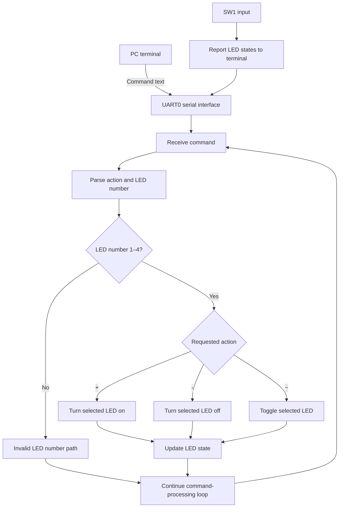

# System Overview

## Purpose

This document summarizes the PC-to-microcontroller UART LED-control task described in the Lab 4 presentation. The firmware source is intentionally excluded because permission to redistribute it has not been granted.

## Components

- **PC terminal:** sends command text and displays status information.
- **UART0:** serial link between the terminal and the microcontroller.
- **Tiva TM4C1294XL evaluation board:** runs the embedded firmware and provides four user LEDs.
- **SW1:** input used by the described program to report which LEDs are currently on.

## Conceptual data flow

This is an original high-level diagram based on the task and flowchart in the presentation. It is explanatory and does not represent the restricted source code line by line.

## UART configuration described by the presentation

The presentation specifies UART0, a target baud rate of 9600 bit/s, and an 8-N-1 serial format. It also describes a 16 MHz system-clock assumption for the baud-rate calculation. The README intentionally does not claim independent verification of those settings on hardware.

## Boundaries and unknowns

The available presentation does not fully define the exact command string syntax, separators, terminal response text, or all wiring details. Those items are left unspecified rather than inferred. Use permitted documentation and your own notes to fill in any details you are allowed to share.

## Source and redistribution note

This file is a fresh summary of the reported design. It does not include firmware, instructor-provided source, or a reproduced slide image.
